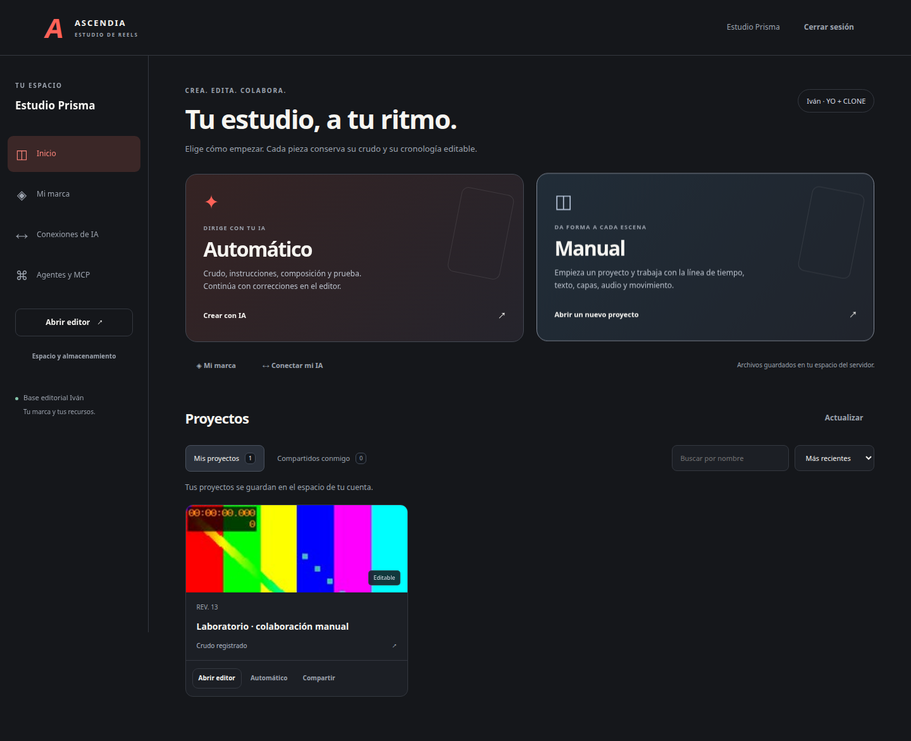
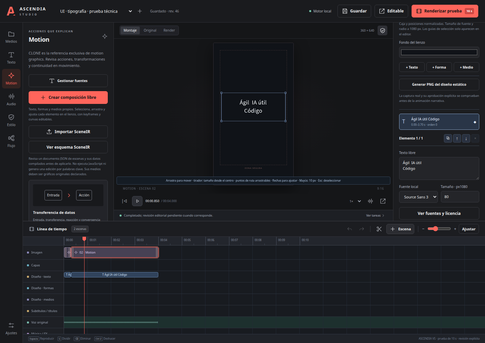

# Ascendia Studio

Software web de código abierto para convertir crudos en proyectos editables,
con cuentas, espacios privados, branding propio, render y automatización API/CLI/MCP.
Todo lo creado permanece dentro de SOFTWARE; la producción de IVAN y su
terminal se mantienen independientes.

La versión 0.6 añade una pantalla principal con modos Automático y Manual,
proyectos propios y compartidos, permisos de lectura/edición y conflictos de
revisión. Incluye un pipeline reanudable para crudos de hasta600s, reinicio por
generación, selección de pista de audio y exportación del borrador manual completo.
Los renders completos nuevos son técnicos y conservan la revisión editorial pendiente.
La dirección usa datos cerrados y QC de fuentes reales, tamaño tras escala y
permanencia del texto. Una animación válida requiere revisión visual; las
mediciones geométricas no certifican lectura humana ni pertinencia del montaje.
El almacenamiento actual es local al servidor, con `remote:false`.
Incluye respaldo S3/R2 configurable por el administrador: snapshot de proyecto,
recursos y fuentes, verificación por SHA, manifiesto con CAS y restauración en
staging. La conexión remota está desactivada; no hay sincronización periódica
ni despliegue público. Contratos y límites en [Nube](docs/NUBE.md).
La versión anterior añadió registro/login, aislamiento por usuario, fuentes y colores
por marca y conexiones de IA privadas. Todos parten del perfil IVAN YO + CLONE
adaptado en `profiles/ivan_base.json`. El director puede usar una API propia o
conectar su agente MCP. Las claves API se cifran por espacio; las credenciales
MCP son distintas, revocables y se muestran una sola vez.
Incluye composición libre,
HyperFrames/GSAP, seguimiento facial, segmentación de personas en CPU, importación SceneIR y biblioteca de fuentes con animaciones de texto. No alcanza toda la suite
Adobe o CapCut Pro: rotoscopia, relleno generativo, HDR y Blender siguen pendientes.
El código declara capacidades disponibles y ausentes sin simularlas.
Las decisiones del encargo de IVAN permanecen independientes. El software adapta
sus contratos, prompts y correcciones; no comparte clips, claves, aprobaciones
ni tipografías privadas entre usuarios. Los planes se compilan como SceneIR
editable; una inferencia o un render técnico no certifican fidelidad CLONE.
La narrativa de un reel completo sigue requiriendo revisión y autorización.

El recorrido de ambos modos, los permisos y los contratos API/MCP están en
[la guía operativa](docs/MODOS_COLABORACION_PIPELINE.md) y
[el workflow del reel completo](workflows/reel_multiservice.json).
GSAP conserva su [licencia propia](https://gsap.com/community/standard-license/);
no forma parte del código MIT de este software.





## Abrir

```bash
cd IVAN/SOFTWARE
./iniciar_multiservice.sh
```

Abrir http://127.0.0.1:8776/portal. Crear una cuenta y cargar el crudo en su
espacio. En Marca, elegir colores, logo y fuentes. En Conexiones, introducir
la clave API y el ID exacto de un modelo disponible en esa cuenta. Probar la
conexión y automatizar son acciones explícitas que consumen la API del usuario.
En Agentes, crear una credencial MCP para dirigir el mismo editor desde Codex,
Claude Code u otro cliente compatible. No hay aprobación editorial automática.

La distribución incluye seis fuentes públicas OFL y sus avisos, enumeradas en
`packs/public_fonts.json`; el alta funciona sin los índices privados del operador.
`./instalar.sh` crea el entorno Python dentro de SOFTWARE. FFmpeg/FFprobe,
Node22+, Chrome, HyperFrames y los modelos CPU son dependencias adicionales.
Esta estación reutiliza el runtime del padre sólo por lectura; el despliegue
independiente puede instalar el runtime local con `./instalar.sh --runtime`
(tarea opcional, no ejecutada en esta auditoría) y debe proporcionar sus modelos. No se ha
publicado en un servidor remoto. TLS, recuperación de cuenta, cuotas y cobros
siguen pendientes para el servicio comercial. `./iniciar.sh` conserva el editor
local de operador en8765; no forma parte del gateway multiusuario.

Codex y Claude admiten MCP con autorización Bearer: consultar sus guías
[Codex MCP](https://developers.openai.com/codex/mcp) y
[Claude Code MCP](https://code.claude.com/docs/en/mcp).
El inicio de sesión mediante ChatGPT requiere registro oficial de cliente y
permisos separados para usar el plan; no está habilitado aquí
([guía oficial](https://developers.openai.com/siwc/quickstart)).
La integración API de Claude usa claves de Console. Su login nativo pertenece
a Claude Code; el software no recoge sesiones de claude.ai
([condiciones oficiales](https://code.claude.com/docs/en/legal-and-compliance)).

## Edición

1. Cargar un crudo en Biblioteca y asignarlo al proyecto. La app inspecciona
   contenedor/pistas, genera miniaturas/waveform y deduplica por SHA-256.
2. Leer el manual desde Estilo y observar YO y CLONE en secuencia: YO define
   cámara/subtítulos/split; CLONE, exclusivamente motion. Registrar observación
   y evidencia propia dentro de SOFTWARE. Los manuales del padre son solo lectura.
3. Analizar audio. ASR CPU es opcional; descarga su modelo dentro de .estado/models
   únicamente cuando se solicita. Revisar nombres, cifras y tiempos resultantes.
4. Crear storyboard: el borrador heurístico sigue frases del crudo y propone
   recursos por texto. El director debe evaluar contexto, elegir/ver clips y
   registrar búsquedas, selección/descarte y evidencia por escena.
5. Editar escenas, textos, split, foco/barbilla, keyframes y color; añadir música,
   ducking, riser y SFX. Las cuatro plantillas motion son esquemas conceptuales,
   nunca interfaces auténticas ni resultados demostrados de productos.
   «Composición libre» permite texto, formas y medios, selección, arrastre,
   tamaño, orden, trayectorias, curvas y máscaras animadas. El diseño base se
   captura como PNG antes de su revisión explícita. Elegir el motor guardado
   en los ajustes: nativo o HyperFrames/GSAP.
   El inspector permite hasta ocho capas independientes por escena: PNG/WebP
   transparentes o video, entrada/salida, posición, escala, opacidad y Screen.
6. En Exportar, elegir prueba técnica del editor para obtener hasta 10 s de MP4.
   Revisar MP4/proxy en movimiento, comprobar zonas seguras y recursos,
   escuchar mezcla y corregir. Es una prueba del software, sin aprobación de estilo.
7. Registrar observaciones y exportar el editable. La vía narrativa exige además
   adaptador HyperFrames/GSAP, diseño CLONE aprobado, doce guías y sus evidencias.
   Su aprobación depende de todas esas evidencias vigentes, además del MP4.
   El completo permanece
   bloqueado hasta la aprobación de prueba y una autorización posterior.

El preview del navegador aproxima la composición; el MP4 renderizado es la
referencia de evaluación. Una cronología programada no prueba aparición real:
el manifest distingue programación de verificación visual del exportado.

En «Fuentes» se pueden importar TTF/OTF locales de hasta 16 MiB y consultar su
familia, variante real, SHA y aviso de licencia. La biblioteca inicial añade
Source Sans 3 Regular/Bold, Anton Regular, DM Serif Display Regular/Italic e IBM
Plex Mono Regular, con archivos originales y avisos OFL. No usa fuentes de red
ni simula negritas o cursivas. Sequel y Scholar mantienen sus roles ASCENDIA.

Seleccionar un texto en Composición libre para ajustar alineación horizontal
y vertical, espaciado, interlineado, contorno y sombra. Sus siete opciones de
entrada son sin animación, subida, deslizamiento, pop, revelación, máquina de
escribir y aparición por palabras; la salida puede ser sin efecto, fade o
deslizamiento. Cortar o dividir conserva el reloj original de la animación.
La vista usa las medidas del backend; el MP4 sigue siendo la comprobación final.
Los ZIP conservan las fuentes adjuntas y sus avisos. Capacidades y pendientes:
[docs/TIPOGRAFIA.md](docs/TIPOGRAFIA.md).

Se probaron Tiny y Small con habla real en español. Small puede elegirse en
Texto o con `--model small`; su modelo ya está en la caché local. Revisa marcas
y nombres: el ASR no garantiza transcripción exacta. Puedes corregir bloques y
palabras alineadas antes de crear el storyboard o los subtítulos.

Los formatos que el navegador no reproduce usan una vista previa local
H.264/AAC; videos con transparencia usan VP9 alpha/Opus. El render procesa
el original. La compatibilidad depende de los decodificadores FFmpeg y del
navegador instalado; no se garantiza cualquier archivo existente.

En Motion, «Importar SceneIR» acepta JSON local, muestra la propuesta y aplica
el reemplazo de cronología solo tras una decisión explícita. Conserva crudo,
voz, audio y transcripción. Texto, formas, máscaras, trayectorias y acciones
quedan editables; los parámetros textuales son literales. Los componentes duran
hasta diez segundos y se renderizan técnicamente sin aprobación por pieza;
QC, fidelidad y derechos permanecen pendientes. El esquema está en la interfaz,
en CLI y en GET /api/scene-ir/schema. No ejecuta HTML ni JavaScript importado.

El seguimiento mide rostro, foco y barbilla estimada en muestras del original;
guarda JPG, tiempos medidos, confianza y procedencia del modelo. No cambia
escenas ni aprueba contenido. Las coordenadas originales deben transformarse
según el recorte y el split antes de aplicarlas. Perfil, oclusiones, varias
personas y huecos de detección requieren revisión visual.

En «Ver clip» están las herramientas de inspección, detección de cortes,
medición LUFS/pico real, extracción WAV, reducción de ruido, normalización,
proxy, velocidad, reversa, chroma key y eliminación del fondo de personas. Los derivados
conservan procedencia y no reemplazan el original. La reversa admite hasta
60 s y limita el uso estimado de memoria.

Para eliminar un fondo, abrir «Ver clip», desplegar Herramientas y elegir
«Eliminar fondo de persona». Ajustar el tramo y procesar: se crea un MOV con
alfa y audio original decodificado a PCM, además de una vista WebM transparente.
Los fondos de cuadros, claro y oscuro permiten examinar los bordes. El catálogo
muestra también herramientas pendientes con su motivo; distingue modelo
disponible de ejecución verificada. El modelo y el runtime quedan en `.estado`.
La cancelación elimina los candidatos incompletos. Si el proyecto cambió
mientras se procesaba, el resultado queda en la biblioteca sin sobrescribirlo.

Esta segmentación admite SDR, hasta 30 s, 900 fotogramas y 2 GiB de RGBA
procesado, con resolución y FPS limitados por el catálogo. Puede conservar
objetos próximos, perder detalles finos o variar en los bordes; requiere revisión
en movimiento. No sustituye la rotoscopia ni altera automáticamente el fondo
auténtico exigido para el presentador de ASCENDIA.

Las capturas de segmentación que contienen material privado se excluyen de la
distribución pública.

## Automatización

```bash
python3 -B -m studio preflight
python3 -B -m studio projects
python3 -B -m studio import assets/video/mi_crudo.mp4
python3 -B -m studio create --name "Nuevo reel" --source ID_RECURSO
python3 -B -m studio automate ID_PROYECTO --transcribe --model small
python3 -B -m studio get ID_PROYECTO
python3 -B -m studio validate ID_PROYECTO
python3 -B -m studio render ID_PROYECTO --seconds 10 --technical
python3 -B -m studio render ID_PROYECTO --seconds 10 --technical --engine hyperframes
python3 -B -m studio tracking ID_PROYECTO
python3 -B -m studio tracking-proposals ID_PROYECTO
python3 -B -m studio design-snapshot ID_PROYECTO ID_ESCENA
python3 -B -m studio design-review ID_PROYECTO projects/ID_PROYECTO/revision_diseno.json
python3 -B -m studio scene-ir-schema
python3 -B -m studio scene-ir-preview ID_PROYECTO projects/ID_PROYECTO/escena.json
python3 -B -m studio scene-ir-apply ID_PROYECTO projects/ID_PROYECTO/escena.json --expected-revision REVISION
python3 -B -m studio skills ID_PROYECTO --prepare
python3 -B -m studio export ID_PROYECTO
python3 -B -m studio open exports/ID_PROYECTO_editable.zip
python3 -B -m studio media-tools
python3 -B -m studio font-library
python3 -B -m studio text-presets
python3 -B -m studio text-layout ID_PROYECTO projects/ID_PROYECTO/elemento.json --duration 4
python3 -B -m studio job ID_TRABAJO
python3 -B -m studio cancel-job ID_TRABAJO
python3 -B -m studio process ID_RECURSO extract_audio --project ID_PROYECTO
python3 -B -m studio process ID_RECURSO remove_background_video --options workflows/persona_cpu.json --project ID_PROYECTO
python3 -B -m studio mcp
```

`automate` analiza y prepara el storyboard; no inventa recursos vistos, no
aprueba decisiones editoriales y no publica. Si el servidor está abierto,
análisis/render se encolan en su worker serial; la CLI informa el ID del trabajo.
Sin servidor ejecuta esa tarea de forma síncrona. Guardar con revisión antigua
falla para evitar sobrescrituras entre interfaz y agentes.
El editable incorpora también HTML/GSAP del render vigente cuando existe;
los ZIP se comprueban por CRC/SHA y mantienen las licencias originales.
Después de actualizar código, reiniciar el servidor antes de ejecutar trabajos.

Workflows y roles: [workflows/AGENTES.md](workflows/AGENTES.md).
API: [docs/API.md](docs/API.md). Revisión del proceso existente:
[docs/PROCESO_IVAN.md](docs/PROCESO_IVAN.md). Investigación de productos,
repositorios y licencias: [docs/INVESTIGACION.md](docs/INVESTIGACION.md).
Resultados y problemas corregidos: [docs/AUDITORIA.md](docs/AUDITORIA.md).

## Verificación

El cierre v0.5 tiene **1.550 pruebas Python correctas en 218,61 s**, con
`sources_stable:true`; autenticación pasó **14/14 controles**, el editor **13/13**
y el SDK MCP oficial **5/5**, con **45 herramientas**. Los ocho adaptadores BYOK se comprobaron con
transportes simulados, sin llamadas a APIs externas: eso prueba sus contratos,
no una respuesta real de cada proveedor.

La muestra privada ejecutó ASR Small y seguimiento facial CPU con 16 muestras.
El MP4 CPU mide 7,933333 s y 238 fotogramas; la comparación de voz dio Pearson
0,999791 y desfase cero. Son medidas de señal, sin escucha ni aprobación
editorial. El ZIP editable privado actual pesa 12.094.467 bytes y pasó CRC/SHA
y reapertura canónica. **La muestra requiere correcciones**: puntos que ocluyen
«SKILL» entre 2,9–3,2 s, espaciado, representaciones genéricas y el nombre
«Cloud» pendiente de cotejar en el ASR. No certifica fidelidad CLONE.

El perfil adaptado permanece en revisión 2, con sus evidencias históricas.
Los manuales del proceso paralelo siguieron cambiando durante el cierre y se
leyeron completos; las indicaciones posteriores sobre logos auténticos, ritmo
y tiempo de lectura aún requieren adaptación al software. No se heredan
recursos privados, permisos de publicación ni aprobaciones del padre. El SaaS
público, TLS, recuperación de cuenta, cuotas, cobros y registro oficial de
cliente OAuth siguen pendientes.

El paquete público es un checkout de código con documentación, seis fuentes
OFL y cuatro avisos; excluye cuentas, llaves, estado, modelos, crudos, fuentes
privadas, capturas del reel y pruebas internas. La suite siguiente se ejecutó
en el workspace de desarrollo. Tras ella solo se actualizaron README y la
auditoría, sin cambiar código/perfil ni repetir la batería completa. El recibo
de empaquetado distingue estos cambios documentales. Detalles y evidencias:
[docs/AUDITORIA.md](docs/AUDITORIA.md).

```bash
python3 -B -m pytest -p no:cacheprovider --basetemp .estado/tmp/pytest tests
```

Las pruebas usan medios sintéticos propios y muestras privadas de video real,
CPU y temporales locales; no editan
el reel activo. El reporte de entrega registra comprobaciones y límites reales.
MIT cubre código original; recursos, fuentes, modelos y binarios conservan sus
licencias. FFmpeg con libx264 tiene consideraciones GPL al redistribuir binarios.
