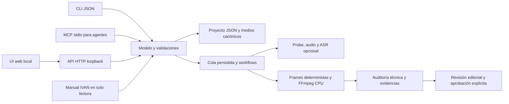
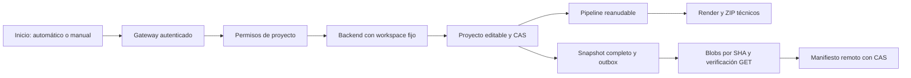

# Arquitectura de Ascendia Studio

Contrato de implementación acordado el 12 de octubre de 2026. Este documento describe responsabilidades y criterios de aceptación; el código y los resultados de pruebas determinan qué capacidades están disponibles. Todo archivo generado, cache, modelo, configuración y exportado vive dentro de `SOFTWARE/`.

## Modelo de operación

Ascendia Studio es un editor local con UI web, API HTTP, CLI JSON y servidor MCP stdio. Los cuatro accesos comparten el proyecto editable y sus validaciones. El servidor HTTP escucha únicamente en loopback. Un worker serial procesa trabajos multimedia con CPU limitada y estado persistido. La producción original de IVAN sigue siendo independiente.



## Módulos y límites

| Módulo | Responsabilidad | Límite |
|---|---|---|
| `studio/core.py` | Paths confinados, almacén JSON atómico, dedup SHA-256, revisión optimista, validación de políticas y manual | No importa el workflow del padre ni escribe en sus proyectos. |
| `studio/analysis.py` | FFprobe, extracción/waveform/silencios; faster-whisper CPU opcional | Modelo/cache en `.estado/models`; no descarga ni usa GPU automáticamente. |
| `studio/motion.py` | Evaluación de curvas, capas y escenas deterministas en Pillow | Templates técnicos editables; no sustituyen decisiones semánticas ni constituyen revisión de YO. |
| `studio/design.py` | Esquema de composición libre, poses, curvas parciales, trayectorias y máscaras | Datos cerrados, 64 elementos y memoria acotada; no ejecuta código de proyecto. |
| `studio/fonts.py` | Inspección SFNT/Unicode/familia/variante, catálogo canónico y avisos por SHA | TTF/OTF individuales≤16MiB, sin instalación de sistema, fallback ni permisos inventados. |
| `studio/typography.py` | Layout medido, grafemas, estilo y reloj de animación compartido | Texto plano por elemento; no suite comercial ni garantía de escritura bidireccional. |
| `studio/design_review.py` | PNG del diseño base y aprobación explícita vinculada a bytes/referencia/manual/código | Rollback del PNG y registro si falla el commit; no aprueba automáticamente. |
| `studio/hyperframes.py` | HTML/GSAP editable, CLI local, check, snapshots y MP4 | CPU, un worker, runtime privado y recibos hash; partes raster declaradas. |
| `studio/tracking.py` | MediaPipe FaceDetector/FaceLandmarker CPU, PTS y evidencia por muestra | Sin cambios de edición; landmarks estimados, confianza del detector y huecos explícitos. |
| `studio/render.py` | Compilar cronología, decodificar medios, componer frames y mezclar/encode FFmpeg | CPU y dos threads; voz continua; exportar candidato/prueba, sin aprobación automática. |
| `studio/jobs.py` | Cola serial persistida, DAG de workflow, roles, leases y artefactos | Un rol asignado no prueba que un agente/modelo ejecutó la tarea. |
| `studio/media_tools.py` | Once operaciones locales, derivados con hash y procedencia | Parámetros cerrados, CPU, originales intactos y reversa acotada. |
| `studio/segmentation.py` | MediaPipe ImageSegmenter WASM CPU, confianza de persona a alfa y MOV QTRLE | SDR, hasta 30 s, 900 frames y 2 GiB RGBA; evidencia/cancelación/caché verificadas; no rotoscopia manual ni cambio de fondo de cliente. |
| `studio/previews.py` | Proxies H.264/AAC o VP9 alpha para el navegador | Derivados explícitos; el render usa el original y no certifica HDR. |
| `studio/bundles.py` | Reapertura ZIP, hashes, recursos y fuentes auténticas | Rechaza escapes, symlinks y paquetes excesivos; reinicia revisión importada. |
| `studio/server.py` | `ThreadingHTTPServer`, REST, raw uploads y HTTP Range | Solo paths autorizados, sin shell arbitrario ni acceso remoto. |
| `studio/cli.py`, `studio/__main__.py` | Operaciones equivalentes a API con salida JSON | Errores explícitos y estados reanudables. |
| `studio/mcp.py` | Herramientas estructuradas para agentes vía stdio | Herramientas con argumentos validados y evidencia; no habilita comandos libres. |
| `web/` | Timeline, biblioteca, preview, inspector, audio, workflow y revisión | JavaScript vanilla local, sin CDN ni servicio cloud requerido. |

## Organización propia

```text
SOFTWARE/
├── studio/                 Núcleo, motores, servidor, CLI y MCP
├── web/                    Interfaz local
├── docs/                   Proceso auditado, fuentes, arquitectura y uso
├── workflows/              Contratos de tareas y roles
├── tests/                  Pruebas funcionales y de aislamiento
├── assets/                 Una copia por hash de medio importado
│   ├── video/              Crudos y videos generales
│   ├── broll/              Clips de recurso importados
│   ├── audio/              Música y SFX
│   ├── fonts/              Fuentes suministradas por el usuario
│   ├── images/             Imágenes y miniaturas
│   └── previews/           Derivados de reproducción web por hash
├── projects/               Proyecto, exportados y artefactos canónicos por fuente
├── .estado/                Temp, caches, modelos, logs y jobs
├── exports/                Paquetes editables exportados
└── ESTADO.json             Continuidad propia, sin tocar ESTADO del padre
```

La ruta exacta de los subdirectorios de datos se obtiene del almacén implementado. Importar significa copiar explícitamente al almacén propio. Se rechazan escapes por `..`, enlaces simbólicos que resuelvan fuera y rutas de salida externas. La aplicación no usa credenciales heredadas, no sigue un symlink para escribir fuera y no instala herramientas globalmente.

## Proyecto editable

El esquema agrupa `source`, `assets`, `timeline`, `transcript`, `audio`, `fonts` y `review`. La cronología conserva tiempos de fuente y salida por separado, tipo de composición, narración, recurso, texto, transformaciones, curvas y cues sonoros. Los assets registran hash, metadata, fuente, derechos y revisión visual. Un medio programado queda con uso previsto; uso real exige evidencia del exportado.

Las escrituras usan archivo temporal y reemplazo atómico. Cada proyecto tiene revisión; una modificación con revisión antigua debe fallar para evitar que UI y dos agentes sobrescriban decisiones. Los archivos multimedia canónicos se deduplican por SHA-256 y conservan original. Los derivados se identifican separadamente para limpieza segura.

El lock del almacén coordina hilos y procesos POSIX para proteger escritores de UI, CLI y MCP. Las huellas de revisión incorporan bytes reales de medios/fuentes. Los jobs capturan la identidad de sus entradas antes del procesamiento y rechazan resultados si esas entradas cambian durante análisis/render. El manifest asocia recursos con rangos realmente decodificados, sin atribuir uso a otro tramo del mismo archivo. Esta evidencia de incorporación sigue necesitando inspección visual editorial.

La revisión se vincula al contenido del proyecto, manual vigente, código real del motor, recursos, fuentes, aplicación de skills y exportado. Cambiar cualquiera invalida nuevas promociones. La prueba narrativa V5 produce diez segundos; el completo exige aprobación de esa prueba y nueva indicación. La regla23 vigente dirige al padre hacia su biblioteca generativa CLONE con render por componente y QC pendiente; la arquitectura del padre ya está comprobada y no se repite. El adaptador propio comprueba recibos de ejecución, código de píxeles, binarios, runtime y evidencias. Un campo de proyecto no puede habilitarlo. La exportación técnica hasta diez segundos conserva technical_library y nunca se aprueba como ASCENDIA.

## Workflow de agentes

La automatización expone tareas para `director`, `resources`, `motion`, `audio` y `qa`. La tarea incluye objetivo, alcance, dependencias, entradas, manual vigente, artefactos permitidos y evidencia exigida. Un lease evita dos responsables simultáneos; la revisión optimista protege el proyecto. Cada agente escribe en su ámbito y el director integra resultados validados. La cola y los roles coordinan clientes externos; no despliegan modelos de IA por sí mismos.

1. El director comprende la narración, identifica bloques y prepara storyboard específico.
2. Recursos busca candidatos contextuales, revisa el clip y registra tramos/decisiones; descartar incluye razón.
3. Motion compone acciones, reacciones, transformación y salida con las fuentes y tiempos acordados.
4. Audio preserva voz, elige entrada musical, programa riser/SFX y registra mediciones y audición cuando exista.
5. QA compara candidato y referencias en movimiento, identifica fallos y documenta evidencias.
6. El usuario aprueba explícitamente la prueba vigente antes de producir el completo.

La cola ejecuta análisis/render disponibles. Las tareas editoriales quedan esperando artefactos de agentes o del editor humano; no se rellenan con textos inventados. El software permite que Codex u otro cliente MCP ejecute esos trabajos; no afirma haber desplegado un modelo solo por crear las tareas.

## Políticas V5

YO define cámara, subtítulos y split; CLONE es referencia exclusiva de motion. AGENT/EDIT se conservan como historia. El preset exige split 55/45, fuente auténtica, ausencia de relleno blur, presencia continua máxima de tres segundos, fuentes Sequel/Scholar reales, sombra compacta, rojo con justificación semántica y representación textual también en b-roll. El hook se diseña editorialmente y no se completa con captions automáticos por defecto.

`studio/skills.py` inventaría por lectura las doce guías canónicas del padre, sin importar su workflow ni escribir fuera de SOFTWARE. Cada proyecto conserva un registro pendiente que debe completar el agente con lectura, revisor, decisión y evidencias actuales con SHA, referencias y consulta del catálogo en inglés. Cambios de árbol o evidencia invalidan la aplicación. Un inventario no prueba comprensión ni ejecución. Un recibo del adaptador ausente o alterado, diseño sin aprobación o aplicación de skills pendiente bloquean aprobación narrativa; las pruebas técnicas siguen disponibles.

La regla25 vigente pide B_V2 del proceso padre, con montaje preservado, comparación
con B_V1, quince familias y CANCELLED; sin nuevas demos ni YO. Ese encargo es
independiente de SOFTWARE. Render/batch de componentes técnicos mantiene
control de calidad y pendientes. El adaptador `studio/scene_ir.py` transforma
SceneIR de datos cerrados a una escena motion/custom editable; la semántica es
aportada por el autor, sin modelo interno ni familias CLONE certificadas.
`scene_ir_actions.py` separa preview sin escritura y aplicación con revisión
optimista. El modo/origen quedan protegidos en el almacén, ZIP y editorial_digest.
El worker ajusta duración del componente y genera recibo técnico, sin reel
aprobado. Su workflow conserva cinco roles con objetivos específicos, sin stock.
La biblioteca real del padre y el CANCELLED aprobado permanecen independientes.

Las validaciones automáticas pueden medir intervalos y datos declarados, detectar incumplimientos estructurales y preparar evidencia. No determinan por sí solas si una animación explica la frase, si el rostro aparece como se declaró, si el split se parece a YO ni si la música molesta. Esas decisiones requieren revisar el candidato en movimiento y distinguir revisión sonora perceptiva de ASR/niveles.

Si faltan fuentes autorizadas, b-roll visto, evidencia, sincronización o cobertura del storyboard, el sistema informa el impedimento. Una demo técnica puede utilizar una fuente de prueba declarada; no sustituye silenciosamente las fuentes del preset Ascendia ni se presenta como entrega aprobada.

## Aceptación y próximos adaptadores

La aceptación inicial exige importar/reutilizar un medio, persistir/editar un proyecto, detectar audio, generar waveform, aplicar texto y motion real, mezclar voz/música/SFX, exportar un MP4 reproducible, reabrir el editable y operar desde UI/CLI/API/MCP. Deben probarse paths confinados, revisiones concurrentes, reanudación de jobs y bloqueo de completo sin aprobación. Las pruebas multimedia usan medios sintéticos propios y muestras privadas de video real, con CPU; no editan los crudos de la terminal ajena.

Auditoría puntual del núcleo/cola: `tests/test_core.py` y `tests/test_jobs.py`, 44 pruebas aprobadas el 12 de octubre de 2026 con `python3 -B -m pytest -p no:cacheprovider tests/test_core.py tests/test_jobs.py --basetemp .estado/tmp/pytest_audit -q`. Incluyen escape por ruta/symlink, conservación ante error atómico, deduplicación, conflicto de revisión, dos escritores en procesos distintos, invalidación por bytes/fuentes, aprobación vinculada al candidato, transcripción con tiempos inválidos, ASR opt-in, revisión de gates al ejecutar cola, cambios de entradas durante procesamiento, tareas stale y manifest con recurso repetido. Las fixtures usan archivos simulados y sustituyen validación de familia tipográfica; este conjunto no ejecuta ASR, GPU ni renders grandes, ni certifica una edición de cliente. Las pruebas de render/API/MCP y la inspección visual tienen evidencias separadas.

La paridad amplia con CapCut/Adobe necesita adaptadores adicionales de rotoscopia, visión/búsqueda multimodal, restauración neuronal, MLT/OTIO, Blender y color/HDR; seguimiento y HyperFrames propios ya tienen implementaciones comprobables. Cada adaptador declara si está ausente, configurado o verificado mediante ejecución; no se usa «premium» como estado técnico. Sus modelos y dependencias deben mantener aislamiento y licencias documentadas.

## Segmentación v0.3

El módulo reutiliza el runtime MediaPipe privado y añade un único modelo
SelfieSegmenter fijado por SHA. Chrome carga una página local propia y ejecuta
WASM con delegado CPU; no importa JavaScript aportado por usuarios ni consulta
un proveedor remoto. FFmpeg entrega frames con geometría normalizada, y un
archivo RGBA temporal acotado evita conservar el video completo en RAM.

El worker mantiene el orden CPU antes del lock del almacén. La espera de CPU
acepta cancelación, y el procesamiento comprueba cambios de entrada/runtime.
La promoción es atómica; se verifican decodificación y alfa de muestras antes
de registrar el recurso. El recibo privado puede enlazar al recurso canónico
solo después de comprobar catálogo, ruta y hash. La huella semántica excluye
únicamente los dos campos de esa asociación, que tienen validación propia.

La biblioteca puede actualizarse mientras hay edición local sin guardar;
el proyecto mantiene sus cambios. Los formularios de clip bloquean operaciones
simultáneas y descartan respuestas correspondientes a otro clip/proyecto.
Las observaciones se guardan en la copia del recurso dentro del proyecto con
revisión optimista; `origin_observed` no modifica la procedencia técnica protegida.

## Tipografía v0.4

El backend mide y distribuye líneas y grafemas con la cara local real, RAQM,
regex y FontTools. Native usa ese layout en Pillow, HyperFrames genera SVG y
GSAP deterministas, y el editor pinta las mismas posiciones mediante el helper
local. Los presets tienen reloj explícito; trim/split mantienen fase y duración
original. Las medidas advierten clipping sin reducir silenciosamente la fuente.

`font_asset_id` se valida contra la biblioteca adjunta y SHA real, separadamente
de `font:primary|accent`. Metadata técnica/avisos están protegidos ante guardados.
El ZIP transporta fuentes y notices; reimportar remapea IDs y conserva avisos
como aportados, sin convertirlos en permisos comprobados. El ZIP HyperFrames
exige además manifiesto incluido en los proof_files y cobertura exacta de bytes.
Cada fuente retiene su licencia; las fuentes de marca no se vuelven MIT.

Los recibos incorporan código de layout/inspección y versiones reales del
runtime tipográfico. Actualizarlos invalida recibos anteriores para nuevas
promociones; no reescribe proyectos ni auditorías históricas.

## Espacios privados v0.5

El navegador usa el gateway8776, registro/login y un namespace inmutable por
workspace. SQLite guarda hashes de contraseñas/sesiones/credenciales MCP. Cada
backend arranca con ASCENDIA_WORKSPACE fijo y un secreto interno; la petición
no modifica ROOT, variables globales ni configuración de otra cuenta. Los
modelos públicos y runtime se comparten por lectura controlada, y todos los
workers adquieren un único lock CPU en SOFTWARE antes de su StoreLock privado.
El límite local actual es12 backends; no equivale a aislamiento entre distintos
usuarios del sistema operativo ni a una infraestructura comercial distribuida.

Branding conserva un snapshot privado por proyecto. API/ZIP no pueden inventar
fuentes o aprobación; aplicar cambios requiere revisión de proyecto y de marca.
El paquete público de seis fuentes OFL funciona sin los catálogos privados del
operador. Los materiales privados y aprobaciones de IVAN nunca se siembran
en cuentas nuevas. Recursos de usuario conservan observación por tramo y SHA.

Las ocho conexiones API usan endpoints fijos y claves AESGCM por espacio.
Autenticación nativa de Codex/Claude permanece en su cliente: MCP sólo concede
herramientas del workspace. ivan_prepare genera ASR/tracking/contexto reales
sin inferencia API. ivan_apply_plan valida dirección externa declarada y
compila SceneIR editable; auto_ivan usa la API propia confirmada. Ambos
encolan un render técnico separado y mantienen QC pendiente. No hay shell
público, aprobación automática, scraping de sesiones ni publicación remota.

Datos canónicos de cada cuenta: workspaces/<id>/assets, projects, exports y
.estado privada. Código, web, perfiles, packs y workflows permanecen en la
raíz SOFTWARE. Este modo deja los proyectos legacy del operador sin migrar.
TLS, recuperación/verificación de cuenta, cobros, cuotas, retención, backup
externo y escala de workers siguen pendientes antes de vender el SaaS.

## Dos modos, permisos por proyecto y respaldo en0.6

El portal ofrece Automático y Manual sobre el mismo modelo editable. Automático
usa `pipeline.py`: análisis del crudo completo, contexto por tramo, dirección
por API propia o agente externo, compilación, QC, commit con CAS, render y ZIP.
Las etapas conservan firmas y artefactos privados; reiniciar crea una generación
nueva y reutiliza ASR/tracking sólo cuando siguen vigentes. El máximo actual
es600s; render y exportación completos son borradores técnicos.

`sharing.py` guarda ACL por proyecto en SQLite. Viewer lee/exporta; editor
guarda mediante CAS y puede renderizar técnico; propietario administra fuente,
branding, automatización, claves y permisos. El gateway revalida sesión y
permiso después de recibir el cuerpo, y serializa admisión y revocación por
proyecto. Un namespace del propietario no cambia la identidad del actor.
Los medios, fuentes, avisos y miniaturas se limitan a adjuntos del proyecto.



`cloud_storage.py` es independiente de las API keys de IA y del acceso de IVAN.
Usa configuración administrativa cifrada, identidades de workspace validadas,
HTTPS limitado a endpoints S3/R2 derivados, SigV4 y recibos por contenido.
El job `cloud_backup` deriva el propietario del proceso; no acepta un owner
suministrado por un cliente. No publica un head hasta verificar todos los
bytes del snapshot. La restauración conserva un staging separado, sin aplicar
proyectos ni transferir aprobaciones. No hay borrado remoto automático.

La instalación actual no tiene configuración ni conexión de nube: el portal
declara almacenamiento local. Tests con transporte inyectado verifican el
contrato, no una cuenta real. La sincronización periódica, el despliegue web
público y los servicios comerciales siguen pendientes. Los detalles y límites
reales se consultan en [NUBE.md](NUBE.md).
